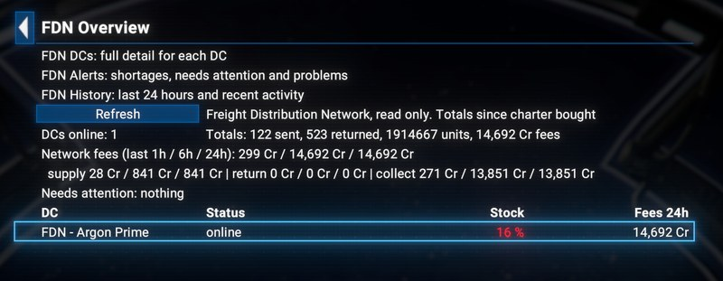
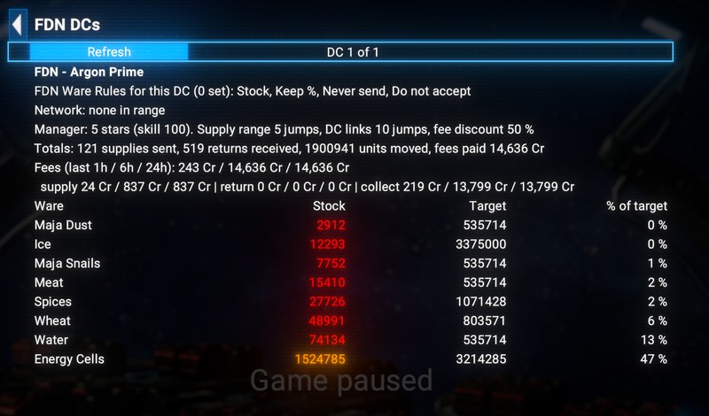
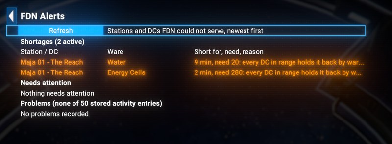
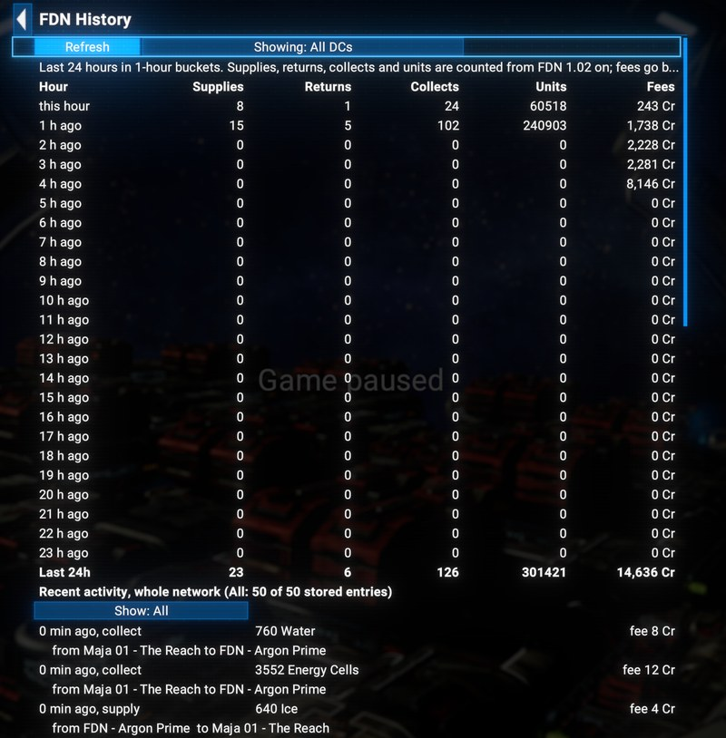
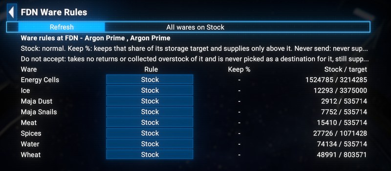
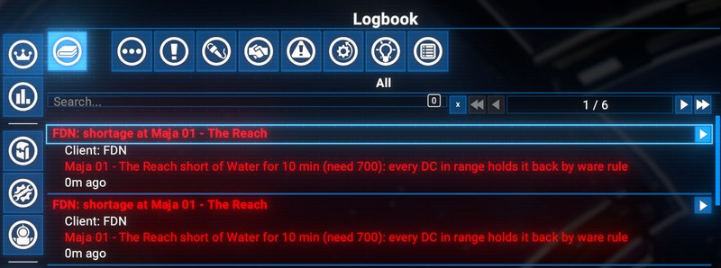
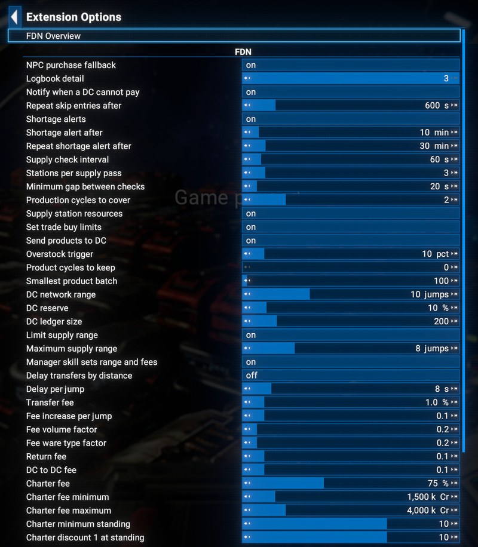

# LI Freight Distribution Network (FDN) for X4: Foundations

**Version:** 1.02 **BETA**
**Author:** Logain Abler (Logain Industries)
**Game:** X4: Foundations **9.00**
**Extension id / folder:** `fdn_x4`
**Licence:** MIT — Copyright (c) 2026 Matthew Ryan (Logain Abler)

Logain Industries Freight Distribution Network (FDN) is a logistics mod for X4: Foundations. Designate player stations as Distribution Centres (DCs), then let FDN supply your production stations from DC stock, return surplus product, and collect overstock — with value- and distance-based fees with adjustable flat volume/type factors, four Overview pages (summary, DCs, Alerts, History), per-DC ware rules, shortage alerts, trade buy limits when enabled, and settings in the SirNukes Mod Support APIs options menu.

This is a **new** mod for X4. It is similar in idea to the Logain Industries FDN script for X3, but it is **not** the same mod and is **not** a port.

> **BETA.** Defaults may change during beta. Back up saves.

## Requirement

- **X4: Foundations 9.00**
- **[SirNukes Mod Support APIs](https://steamcommunity.com/sharedfiles/filedetails/?id=2042901274)** — **required** (Workshop id `2042901274`, folder `sn_mod_support_apis`). FDN uses its Simple Menu API (settings) and Lua loader. Subscribe and enable it yourself.

Protected UI Mode does **not** need to be turned off. FDN is Mission Director scripts plus one small UI Lua file that only reads, sets and clears station storage-level overrides and, when **Set trade buy limits** is on, resource buy limits with vanilla game functions. FDN sets storage levels and resource buy limits (to the FDN storage level, buying turned on), but no sell limits, prices or trade rules.

## Features

- **FDN Charter** — buy a one-off charter on a player station (right-click menu) to make it a Distribution Centre. Fee: 75% of the average price of the **most expensive qualifying dock** on the station (operational dock area or pier from FDN's whitelist: selected Argon/Boron/Terran dock areas and Argon/Paranid/Teladi/Split/Boron/Terran piers; the exact macro whitelist is CharterMacros in md/fdn_core.xml; **not** ship-build bays, equipment docks, Xenon or landmark parts), clamped to 1.5M–4M Cr, then the standing discount. Needs standing 10+ with the sector owner; in player-owned, ownerless, Xenon or Kha'ak sectors it uses your best standing with an eligible economy faction. Discounts 10% / 25% / 40% at standing 10 / 20 / 30. Revoking ends DC status with **no refund**.
- **Automatic membership** — FDN registers every player-owned station, including new ones as they are built. Two per-station right-click toggles, both ON by default: **FDN: resource supply ON/OFF** and **FDN: send products to DC ON/OFF** (the products toggle is hidden on DCs). Global equivalents in settings: **Supply station resources** and **Send products to DC**. Per-station setting overrides global, which overrides the default. A station with no DC in range gets no new FDN supply and runs as normal (its stock levels are handed back; previously queued deliveries may still finish).
- **Home DC and network** — the nearest eligible DC by gate jumps is the station's **home DC** and is tried first. Other DCs must be within range (Maximum supply range, default 5 jumps, or the DC manager's supply range when **Manager skill sets range and fees** is on) and in the home DC's network, tried in order of distance from the home DC. A network is a chain of DCs each linked within **DC network range** (default 10 jumps; 6–10 jumps by manager stars when Manager skill is on), so it can span further overall. Supply from another DC goes directly to the station; the home DC normally pays 0.1× the ordinary supply fee. If it cannot pay, the source DC may pay the full supply fee. A station that is itself a DC is its own home DC. There is no configurable primary DC; no network-size or DC-count cap is implemented in these paths.
- **Manager skill** — each DC's station manager sets that DC's reach and fees: supply range 3 / 4 / 5 jumps at 0–1 / 2–3 / 4–5 stars (never above Maximum supply range), DC-to-DC links 6 / 8 / 10 jumps (never above DC network range; a link uses the smaller of the two DCs), and 10% off the fees that DC pays per manager star (5 stars = 50% off; not the charter fee). A DC with no manager is offline for FDN until one is assigned. Turn **Manager skill sets range and fees** off for flat ranges and fees as in 1.00. With Manager skill on, the manager's supply range (3–5 jumps) still applies even when Range limit is off; turn Manager skill off for unlimited range.
- **Supply** — DCs supply stations with resources for N production cycles from DC stock. If the DC is short, FDN can fall back to an NPC buy (on by default), price capped at the home DC's buy price (the receiving station's buy price is the fallback if the DC has no usable buy price).
- **Product returns** — surplus product above a cycle-based keep goes to the DC (per-ware override available).
- **Overstock collection** — surplus resources follow "send products to DC". Dual-use / self-made wares a station also uses are only collected above 2× need, leaving 1.5×, and not within 10 minutes of an FDN delivery (stops ping-pong).
- **Per-DC ware rules** — on the **FDN Ware Rules** page (linked from **FDN DCs** for the DC shown). Each ware a DC stocks, produces, uses or trades gets a rule: **Stock** (default, normal behaviour), **Keep %** (the DC keeps that share of its storage target, 10–100% in steps of 10, starting at the DC reserve setting; only supplies above it; the larger of Keep % and DC reserve wins), **Never send** (never supplies the ware to stations, directly or through the network; still takes returns and collected overstock), **Do not accept** (takes no returns or collected overstock of the ware and is never chosen as a destination for it; can still supply what it has). Click for the next rule, right-click for the previous. **Reset all to Stock** (two clicks) clears every rule at that DC. The FDN DCs ware table shows the rule after the ware name. Skips caused by a rule are the player's choice: no logbook or Needs attention entry.
- **Stock levels** — FDN sets station stock levels for supplied resources, saves originals, restores them when a ware is no longer needed; never sets product levels; leaves self-made wares to the game.
- **Trade buy limits** — when **Set trade buy limits** is on (default), for every resource FDN sets a stock level for, FDN also sets that ware's trade buy limit to the same level and turns buying on, so NPC traders can top the station up to the FDN level too. Same rules as the stock levels: never for wares the station makes itself, never for products, never on a DC, and only while Supply station resources is on for the station and a DC is in range. FDN saves your own buy limit and whether buying was on, and restores them when the setting is turned off, resource supply is turned off for the station, the ware is no longer needed, the station has no DC in range, becomes a DC, or the charter of the DC ends. Sell limits, prices and trade rules are not changed. Needs a game restart after installing 1.02.
- **Transfers** — instant by default, with value- and distance-based fees with adjustable flat volume/type factors paid by the DC, and an optional distance delay. For returns and collection, an illegal ware may use another legal DC in range; otherwise it stays at the station.
- **FDN Overview pages** (read-only) — four linked pages in Extension Options:
  - **FDN Overview** — network summary, network fees and one short row per DC (name, status, stock %, fees in the last 24h), a one-line Needs attention count, and links to the other pages.
  - **FDN DCs** — full detail for one DC at a time (Network, Manager, totals, fees, ware stock vs target), with a Next DC button; ware table shows the ware rule; link to **FDN Ware Rules**.
  - **FDN Alerts** — active Shortages first (longest first, up to 30 rows: minutes short, need and reason; red once the alert time is reached), the Needs attention list, and Problems from recent activity (10 per page, Newer / Older).
  - **FDN History** — supplies, returns, collects, units and fees per hour for the last 24 hours, with a 24h totals row, for all DCs or one DC (Showing: button). Recent activity lives here (up to 50 entries) with the Show: filter.
- **Shortage alerts** — on-screen ticker and logbook entry (Alerts) when a managed station stays short of an input ware FDN could not supply, or a DC stays low on a ware (usable stock below what the stations it serves need). First alert after **Shortage alert after** game minutes (default 10), then at most once every **Repeat shortage alert after** minutes (default 30) per station or DC and ware. Timer clears when the station is supplied in full or the DC is restocked. A ware set to Never send at a DC never raises that DC's low-stock alert. A station with no free storage for a ware is not counted as short. Settings: **Shortage alerts** (On), **Shortage alert after**, **Repeat shortage alert after**.
- **Warnings and logging** — deduped skip warnings (station + ware + kind + reason; a changed fingerprint or successful move can allow another warning), low DC stock warning, logbook notices, `fdn.log` (log level 1–4).
- **Settings** — in the SirNukes Mod Support APIs options menu.
- **Selling DC surplus** — use normal in-game sell offers on the DC. FDN never sells directly to NPC stations.

## Default settings

Defaults may change during beta.

| Setting | Default |
|--------|---------|
| Range limit | On |
| Max jumps to a DC | 5. With Manager skill on, the manager's supply range (3–5 jumps) still applies even when Range limit is off; turn Manager skill off for unlimited range. |
| DC network range | 10 jumps: DCs each linked within range form a network chain |
| Manager skill sets range and fees | On: supply range 3–5 jumps and DC links 6–10 jumps by manager stars (capped by the two rows above), 10% fee discount per star, DC with no manager offline |
| Cycles to cover | 2 |
| Product cycles to keep | 0 (no product keep; returns start at the minimum batch of 100, not a retained 100) |
| Overstock trigger | Pure resources: 10% above cargo.target; dual-use uses its separate cushion |
| Dual-use / self-made wares | Collect only above 2× need, leave 1.5×, not within 10 min of a delivery |
| DC keep per ware | 10% |
| NPC fallback buying | On |
| Resource supply (global / per-station) | On |
| Send products to DC (global / per-station) | On (per-station products toggle hidden on DCs) |
| Shortage alerts | On |
| Shortage alert after | 10 min (1–120) |
| Repeat shortage alert after | 30 min (5–240) |
| Set trade buy limits | On |
| Fee base | 2% of transfer value × (1 + 0.2 per jump) × volume factor 1.0 × ware type factor 1.0 (volume and ware-type factors adjustable up to 3; range factor up to 1) |
| Return fee | 0.5× the ordinary supply fee |
| Collection fee | 1× the ordinary supply fee |
| DC-to-DC pull fee | Normally 0.1× (home DC pays); source may pay full fee if home cannot |
| Who pays fees | The DC |
| Transfer delay | Off (8 s per jump when on) |
| Charter fee | 75% of most expensive qualifying dock average price, min 1.5M / max 4M Cr |
| Charter standing | Needs 10+ with sector owner (player/ownerless/Xenon/Kha'ak: best standing with an eligible economy faction); discounts 10% / 25% / 40% at standing 10 / 20 / 30 |
| Charter revoke | No refund |
| Log level | 3 (1–4) |
| Logbook level | 2 |
| DC ledger size | Adjustable in settings (default 200 entries per DC; range 50–1000); recent activity is a separate 50-entry list on FDN History |

## How to use

1. Install FDN and SirNukes Mod Support APIs; enable both in the Extension Manager.
2. FDN registers all player-owned stations automatically. On a station, right-click and **buy an FDN Charter** to make it a Distribution Centre.
3. Use the per-station toggles (or the global settings) for **resource supply** and **send products to DC**.
4. Give every DC a station manager (better managers reach further and pay lower fees).
5. Use the **FDN Overview** pages for status: the summary page for network fees and DC rows; **FDN DCs** for one DC in detail and a link to **FDN Ware Rules**; **FDN Alerts** for shortages, Needs attention and recent problems; **FDN History** for 24h hourly counts and recent activity.
6. Adjust **settings** in the SirNukes Mod Support APIs options menu (Shortage alerts, Set trade buy limits, Manager skill, range and fees).
7. **Revoke** a charter to stop using a station as a DC (no refund).

## Install

### Steam Workshop

1. Subscribe to this mod and to [SirNukes Mod Support APIs](https://steamcommunity.com/sharedfiles/filedetails/?id=2042901274).
2. Enable both in the Extension Manager.

Workshop link: https://steamcommunity.com/sharedfiles/filedetails/?id=3835284205

### Manual zip (GitHub / GOG)

1. Download the release zip from https://github.com/mattryan72/FDN_X4/releases
2. Extract the zip into `X4 Foundations\extensions\` (the zip contains the `fdn_x4` folder, so you end up with `X4 Foundations\extensions\fdn_x4\content.xml`)
3. Install SirNukes Mod Support APIs into `X4 Foundations\extensions\sn_mod_support_apis`
4. Enable both in the Extension Manager

> **Install location:** Manual installs must go in the game's own `X4 Foundations\extensions\` folder, not under `Documents\Egosoft\X4\<id>\extensions\`. The required Mod Support APIs dependency is not found when FDN is installed only in the Documents extensions folder (tested).

> **Workshop or GitHub — pick one.** Workshop installs use extension id `ws_3835284205` and GitHub/manual installs use `fdn_x4`, so saves don't carry over between them. Pick one and don't install both.

### Updating from 1.01

v1.00 and v1.01 saves update in place; no steps needed.

- **Steam Workshop:** Steam updates the mod for you.
- **Manual zip:** close the game, delete the old `X4 Foundations\extensions\fdn_x4` folder, then extract the new zip into `X4 Foundations\extensions\`. Settings, DC state, ware rules, shortage timers and saved buy limits live in the save, so nothing is lost.
- **Set trade buy limits** needs a **game restart** after installing 1.02 (the FDN UI helper changed); it works with Protected UI Mode on, like the stock levels.
- Hourly counts (supplies / returns / collects / units) start at zero when 1.02 is installed; hourly fees already recorded still show. Older saves start with every ware on Stock and no shortages.
- **Manager skill sets range and fees** is still present and still defaults **on** (not new in 1.02). A DC without a station manager stays offline for FDN while it is on.

### Updating from 1.00

v1.00 saves update in place; no steps needed. Follow the same Workshop / manual steps as Updating from 1.01, including the game restart for **Set trade buy limits**. **Manager skill sets range and fees** starts **on**: any DC without a station manager goes offline for FDN, and DCs with 0–3 star managers reach 3–4 jumps instead of 5. Check the FDN Overview after the first supply check, or turn the setting off for 1.00 behaviour.

`README.md` and `LICENSE` ship in the extension root. The PDF user guide is on GitHub at https://github.com/mattryan72/FDN_X4/blob/main/docs/FDN_X4_User_Guide_v1.02_BETA.pdf and is also attached to each release (it is not shipped inside the mod package).

## Save safety / Uninstall

Adding FDN to an existing save creates FDN's data on load. The DC ledger defaults to 200 entries per DC (UI range 50–1000), and recent activity keeps 50 entries. There is no overall save-size bound; not every saved table or pending-transfer list has a fixed cap. Setting LedgerMax to 0 or below outside the UI bypasses ledger trimming. Back up first.

### Recommended uninstall steps

Reason: FDN sets real station storage levels (and, when Set trade buy limits is on, resource buy limits), which stay in the save if the mod is simply removed.

1. Back up your save.
2. With FDN still enabled, revoke every charter (**FDN: revoke charter (no refund)**); optionally switch resource supply OFF (and/or Set trade buy limits OFF so buy limits restore).
3. Keep FDN and Mod Support APIs enabled until saved levels and buy limits have been restored: check **RESTORED** (or already-original) messages and **SOLO** for managed stations losing service; fdn.log also shows `trade limits:` RESTORED lines at Debug log detail 3. Resolve restore/helper failures and inspect original manual/automatic levels. If transfer delay was on, let queued deliveries finish before removing FDN. Per-station switches override global settings.
4. Save to a new slot, disable FDN, load.

## Bug reports

Please report on the Egosoft forum thread (https://forum.egosoft.com/viewtopic.php?t=477605) and include:

- X4 version, DLC, FDN v1.02, and whether you use the Workshop or GitHub install
- What you did and what went wrong
- `fdn.log` from `Documents\Egosoft\X4\<id>\fdn.log`, with **log level 4**, then reproduce the issue

## Screenshots

From a v1.02 test game (example values, not a default configuration).

*FDN Overview: links to FDN DCs, FDN Alerts and FDN History, network totals and fees, the Needs attention count and one row per DC.*

*FDN DCs: one DC in detail. Ware Rules link, Network, a 5-star Manager row (supply range 5 jumps, DC links 10 jumps, fee discount 50%), totals, fees and ware stock vs target.*

*FDN Alerts: two active Shortages (minutes short, need and reason), then Needs attention and Problems.*

*FDN History: supplies, returns, collects, units and fees per hour for the last 24 hours, the 24h totals row, and the start of Recent activity.*

*FDN Ware Rules: one rule button per ware (Stock / Keep % / Never send / Do not accept), with stock vs target.*

*Shortage alerts in the logbook: "FDN: shortage at ..." with the ware, minutes short, need and reason.*

*FDN settings from a tuned game, not the defaults (for example Maximum supply range 8 jumps, Transfer fee 1.0%). The new rows (Shortage alerts, Shortage alert after, Repeat shortage alert after, Set trade buy limits) show their defaults. See [Default settings](#default-settings).*

## Credits

- FDN by Logain Abler (Logain Industries)
- SirNukes Mod Support APIs by SirNukes — required dependency (Simple Menu API and Lua loader)

## Licence

MIT License — Copyright (c) 2026 Matthew Ryan (Logain Abler). See [LICENSE](LICENSE).

## Links

- Egosoft forum (X4 Scripts and Modding): https://forum.egosoft.com/viewtopic.php?t=477605
- Steam Workshop: https://steamcommunity.com/sharedfiles/filedetails/?id=3835284205
- GitHub: https://github.com/mattryan72/FDN_X4
- Releases: https://github.com/mattryan72/FDN_X4/releases
- User guide (PDF): https://github.com/mattryan72/FDN_X4/blob/main/docs/FDN_X4_User_Guide_v1.02_BETA.pdf
- SirNukes Mod Support APIs: https://steamcommunity.com/sharedfiles/filedetails/?id=2042901274

Unofficial fan content. Requires a legally owned copy of X4: Foundations. Distributed free of charge under the MIT License (which permits commercial use). No Egosoft assets are redistributed.
